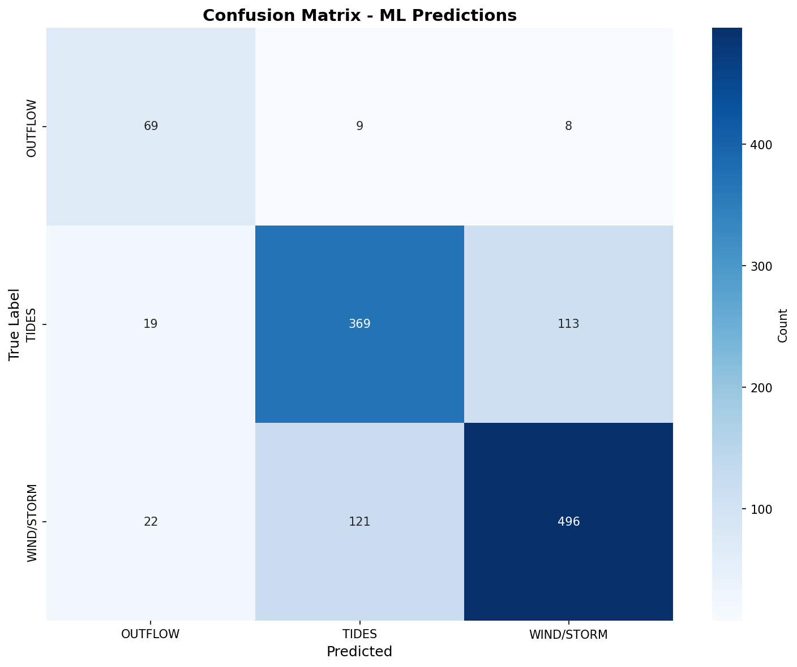

We placed 1st in Canada, which got us to the Grand Finale in Brest, France, and we came 2nd in the world there.

Ocean Networks Canada runs HF radar that maps the surface currents across the Strait of Georgia every hour. Our question was simple to say and annoying to answer: looking at one of those maps, plus the weather and tides at the time, which force is actually driving the water?

## The data problem

We had two years of hourly radar maps, 17,500+ of them, plus wind from buoys, tide gauges and Fraser River discharge at Deas Island. What we didn't have was a single label. Nobody had ever marked a map as "this one is tides".

So we made our own. 1,000 maps were labelled by Gemini 2.5 Pro, and the rest by physics rules written from the tide, wind and river readings. We kept 8,168 cleanly labelled maps and held out 1,226 of them for testing.

## The model

My part was the model and the pipeline feeding it. I parsed the raw radar vector files, built features like how well the wind lines up with the current and a flag for the spring freshet, and fused an ImageNet-pretrained EfficientNet-B4 (for the map) with a small network for those numbers. It trained for 100 epochs on an H200 GPU, with class weights because the river class is much smaller than the others. We wrapped it in a Streamlit app that pulls live public data.

## How it did

76.2% on the test set, 934 out of 1,226. By class: 80.2% for river outflow, 73.7% for tides, 77.6% for wind and storms.

I'm not going to oversell that number. When we checked against the physics afterwards, only 4.7% of the signal's variance was tidal and the correlations with the drivers were weak. Some of what the model learned is probably the quirks of our own labels. Real observed labels would be the obvious next fix.

<small>Radar imagery: Ocean Networks Canada, Oceans 3.0.</small>
