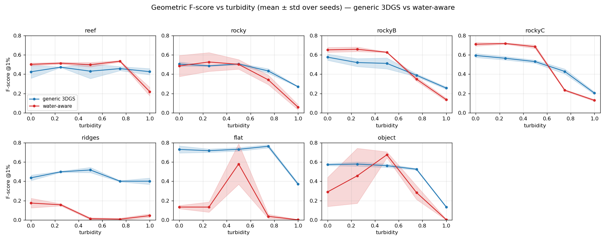

Papers on underwater 3D reconstruction mostly judge their methods by how good the rendered images look. The trouble is that a model can produce a convincing picture from the camera angles it trained on while the 3D shape behind it is wrong. Real underwater footage has no ground-truth 3D to check against, so nobody really knows.

So this project builds scenes where we do know the answer, and measures the geometry directly. It isn't a new method. It's a fair test of the existing ones.

## Building the test

There are 7 seabed scenes made in Blender from Python: a reef, three rocky ones, ridges, a flat seabed and a single object. Each is filmed from 24 angles, with the exact depth, normals, camera positions and mesh saved alongside.

The water is added afterwards with a physics model of how light behaves underwater (the Akkaynak–Treibitz model), from clear to murky. That way the same scene can be tested at five levels of turbidity without rendering it again.

The main comparison is generic 3D Gaussian Splatting against a water-aware version (WaterSplatting), on every scene and every turbidity level, three random seeds each. That's 210 runs on Northeastern's cluster. COLMAP photogrammetry, SeaSplat and NeRF were run as smaller side comparisons on a few scenes. Each reconstruction gets lined up with the true mesh and scored on how close its surface is.

## What came out

- Generic 3DGS never fell apart. It was the only method that stayed usable on every scene.
- Water-aware 3DGS helps on rugged, high-relief scenes in fairly clear water. On one rocky scene it scored 0.717 ± 0.007 against 0.565 ± 0.018. Past about t = 0.6 that advantage flips.
- On flat or gently ridged seabeds it fails badly, near zero almost everywhere (0.002 to 0.175 on most runs), where generic 3DGS stays between 0.37 and 0.76.
- An early single-run result said water-aware won on one rocky scene (0.516 vs 0.452). With three seeds the gap disappeared into noise. That's why the main results are averages over seeds.

One more thing worth admitting: partway through, an old copy of the evaluator on the cluster was producing scores that were physically impossible. It got caught and those results were re-scored with the correct evaluator before anything was written up.

The code isn't public yet while the write-up is in progress.
